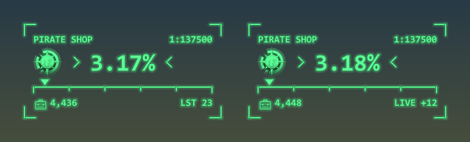
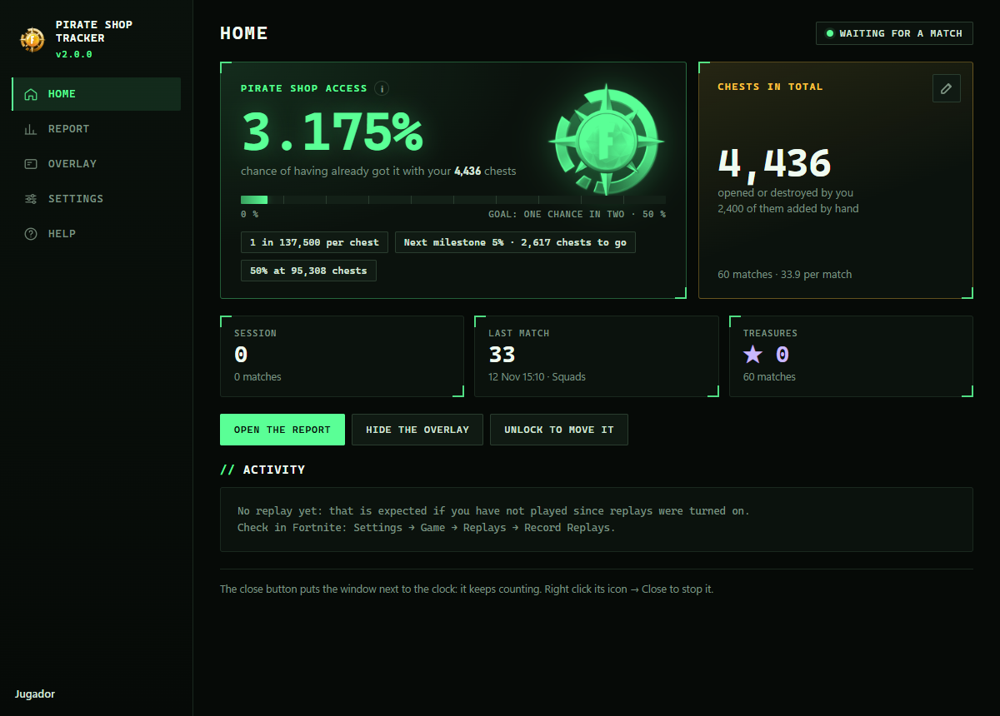
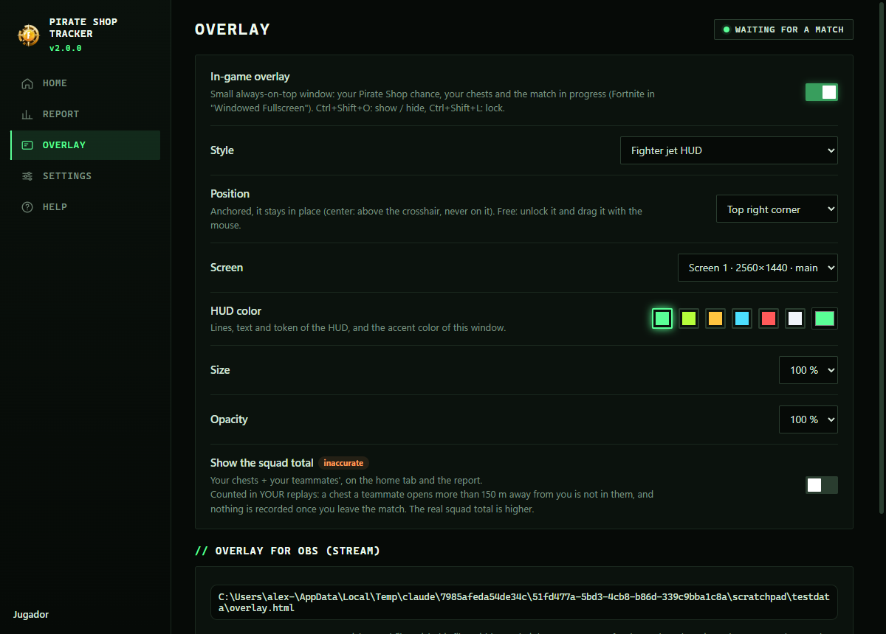

# 🏴‍☠️ Pirate Token Odds Tool

    [](https://github.com/Ren0X1/Pirate-Token-Odds-Tool/releases/latest) [](https://github.com/Ren0X1/Pirate-Token-Odds-Tool/releases) [](https://github.com/Ren0X1/Pirate-Token-Odds-Tool/actions/workflows/build.yml) [](LICENSE)

> **How close are you to the Pirate Shop Access?** Every chest you open is one more roll of a **1 in 137,500** dice. This counts your chests from Fortnite's replays and shows your real, growing chance — on a fighter-jet HUD right over the game. 🎯

**Pirate Shop Tracker** reads the replays Fortnite saves after every match, counts the chests you opened and turns them into the chance of having already got the **Pirate Shop Access** token:

```
P = 1 − (1 − 1/137,500) ^ chests
```

Each chest keeps the same odds; what grows with every chest is the chance of having hit it at least once. The number moves live during a match, and the overlay shows it in a military head-up display that stays out of your way. 🪖

<p align="center"></p>

---

## ⚡ Quick start

1. ⬇️ Download **[`PirateShopTracker.exe`](https://github.com/Ren0X1/Pirate-Token-Odds-Tool/releases/latest)** — one file, nothing to install.
2. 🎮 In Fortnite turn on replays: *Settings → Game → Replays → **Record Replays: On***.
3. 🖱️ Run `PirateShopTracker.exe`. The replays already on your PC are counted straight away.
4. 🪟 Set Fortnite to **Windowed Fullscreen** (*Settings → Video → Window Mode*) so the HUD can show on top of it.
5. 🏁 Play. A few seconds after each match its chests are added and your chance goes up.

> 🛡️ Windows may say *"Windows protected your PC"* because the exe is not signed: *More info → Run anyway*.

> 💡 Opened chests before using the tool? Click the ✏️ pencil on **Chests in total** to add them, or let it estimate them from the match count in Fortnite's *Career → Stats*.

---

## 🖥️ The app

<p align="center"></p>

| Tab | What you get |
|-----|--------------|
| 🏠 **Home** | Your Pirate Shop chance, a 0 → 50 % meter, the next milestone, chests in total, session, last match, treasures, activity |
| 📊 **Report** | Chests per day, chest types, every treasure hunt chance, your collection, the last matches |
| 🎯 **Overlay** | Style, position, screen, HUD color, animations, size, opacity and the OBS page |
| ⚙️ **Settings** | Language, notification area, open with Fortnite, updates, replays folder |
| ❓ **Help** | Data folder, error log, uninstall |

The ❌ close button sends the window **next to the clock** and the tool keeps counting. **Right click** the tray icon → **Close** to stop it.

---

## 🎯 The HUD overlay

<p align="center"></p>

| Option | Choices |
|--------|---------|
| **Style** | ✈️ **Fighter jet HUD** (default) · 🔢 HUD (figures only) · 🃏 Compact card |
| **Position** | 🖱️ Free (drag it) · ↖️ ⬆️ ↗️ corners and top center · 🎯 **Center (head-up)**, above the crosshair · ↙️ ↘️ bottom corners |
| **Screen** | Any of your monitors (shows up with more than one) |
| **HUD color** | 🟢 Military green (default), lime, amber, cyan, red, white or any color you pick |
| **Animations** | ✨ Phosphor flicker, scan sweep and a glitch now and then — turn them off for a still picture |

| Shortcut | What it does |
|----------|--------------|
| **Ctrl+Shift+O** | Show / hide the overlay, from anywhere, even in game |
| **Ctrl+Shift+L** | Lock (the mouse goes through it) / unlock (drag it, right click hides it) |

> 📺 **Streaming?** The tool keeps writing `%APPDATA%\PirateShopTracker\overlay.html`: the same HUD on a transparent background for an OBS *Browser* source (*Local file*, 300 × 170). **Copy the path** in the Overlay tab does it for you.

---

## 🔄 Updates

On start the tool checks this repository's **latest GitHub release**. When there is a newer one, the Home tab shows **New version available** with its notes and an **Install** button: it downloads, checks and restarts — your history and settings are kept. Choose *Offered* (default), *Installed automatically* or *Off* in **Settings**.

---

## 🔒 Safe by design

- ✅ **Reads replays only** — the `.replay` files in `%LOCALAPPDATA%\FortniteGame\Saved\Demos`, opened read-only.
- ✅ **No game modification, no memory access** — it never touches the Fortnite process or its install folder.
- ✅ **No account, no telemetry** — it only talks to GitHub: releases, and the treasure hunt data and pictures.
- ✅ **Nothing exposed to the network** — the window is a page served to `127.0.0.1` only, with a random key.
- ✅ **Light** — below-normal priority, efficiency mode on Windows 11, sleeps between matches.

---

## 📁 Your data

Everything lives in `%APPDATA%\PirateShopTracker` (*Help → Open the data folder*). Coming from Fortnite Chest Counter? Your history in `%APPDATA%\ChestCounter` is copied over on the first start. 📦

| File | Content |
|------|---------|
| `data.json` | Your whole history — back it up if you change PC |
| `config.json` | Settings, overlay position, HUD color |
| `report.html` | The report, to open in a browser |
| `overlay.html` | The HUD for OBS |
| `matches.csv` | One line per match, for Excel / Google Sheets |
| `errors.log` | Unreadable replays, to attach to a bug report |

---

## 🛠️ Build it yourself

Install the [.NET 10 SDK](https://dotnet.microsoft.com/download/dotnet/10.0) (Windows x64) and double-click **`build.bat`** → `dist\PirateShopTracker.exe`.

GitHub Actions builds the exe on every push and attaches it to a release when a `v*` tag is pushed, with [`RELEASE_NOTES.md`](RELEASE_NOTES.md) as the text (also shown in the app after an update).

```bat
PirateShopTracker.exe --lang <fr|en|es>             :: language
PirateShopTracker.exe --demos <folder>              :: another replays folder
PirateShopTracker.exe --data <folder>               :: another data folder
PirateShopTracker.exe --once                        :: analyze the finished replays and quit
PirateShopTracker.exe --overlay-preview <file.png>  :: save overlay previews and quit
```

---

## 🙏 Credits

Built on **[Fortnite Chest Counter](https://github.com/LED-N/Fortnite-ChestCounter)** by LED-N (MIT): the replay reading, chest counting and treasure hunt data come from it. Replay parsing is based on [FortniteReplayDecompressor](https://github.com/Shiqan/FortniteReplayDecompressor) by Shiqan (MIT), see [`lib/PATCHES.md`](lib/PATCHES.md). Treasure pictures and times: [fortnite.bot](https://fortnite.bot).

📜 [MIT License](LICENSE). Not affiliated with, endorsed or sponsored by Epic Games. Fortnite and the Pirate Shop Access artwork are trademarks of Epic Games, Inc.
